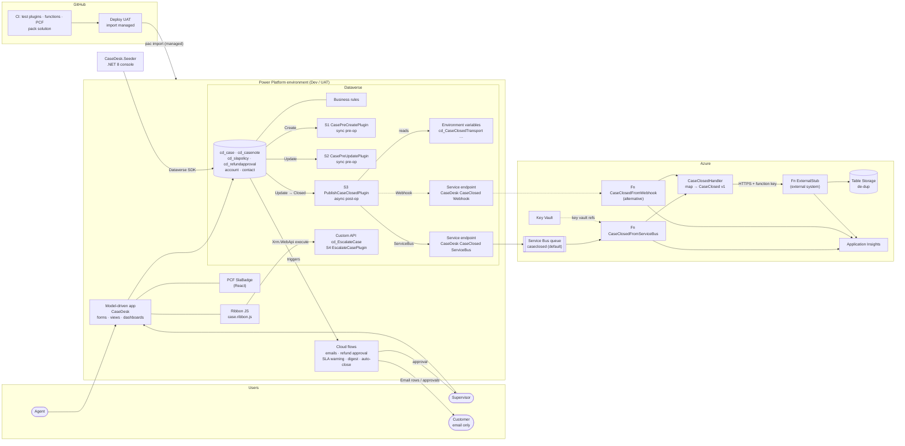

# CaseDesk architecture

CaseDesk is a model-driven app on Dataverse with four custom tables (`cd_case`,
`cd_casenote`, `cd_slapolicy`, `cd_refundapproval`) plus standard Account and Contact. Each
requirement uses the simplest extension point that meets it (constitution I). The design source
is [`specs/001-casedesk-case-management`](../specs/001-casedesk-case-management/plan.md).

## Components

| Component | Where | Role |
| --- | --- | --- |
| Model-driven app *CaseDesk* | `solution/src/AppModules` | Forms, views, dashboards, ribbon Escalate button |
| Dataverse tables, choices, auto-number, alternate key | `solution/src/Entities`, `OptionSets` | Data model; Case Number `CD-{SEQNUM:5}`; one SLA policy per priority |
| Business rules | `solution/src/Workflows/*.xaml` | Refund Amount show/require; SLA warning < resolution |
| C# plugins (net462) | `plugins/CaseDesk.Plugins` | S1 pre-create (due date), S2 pre-update (lifecycle, open-note guard, refund routing), S3 async CaseClosed publish, S4 Escalate Custom API |
| Custom API `cd_EscalateCase` | `solution/src/customapis` | Reusable escalation, called from ribbon JS, flows and external callers |
| PCF `CaseDesk.SlaBadge` | `pcf/SlaBadge` | Live green/amber/red countdown bound to `cd_duedate` |
| Cloud flows | `solution/src/Workflows/*.json` | Customer emails, refund approval, SLA warning, breach digest, auto-close |
| Security roles + BUs | `solution/src/Roles`; BUs/team by seeder | Agent (BU) and Supervisor (Org) |
| Environment variables | `solution/src/environmentvariabledefinitions` | `cd_CaseClosedTransport` switch, endpoint names, team name, sender, auto-close days |
| Service endpoints | Registered per environment (PRT / `pac`) | Service Bus queue `caseclosed` and webhook; secrets entered there, never in source |
| Azure Functions (.NET 8 isolated) | `functions/CaseDesk.Functions` | `CaseClosedFromServiceBus`, `CaseClosedFromWebhook`, shared `CaseClosedHandler`, `ExternalStub` |
| Azure infra | `functions/infra/main.bicep` | Function app, Storage (stub de-dup table), Service Bus Basic, Key Vault, App Insights |
| Seeder (.NET 8) | `tools/CaseDesk.Seeder` | Idempotent demo data, BUs, supervisor team (inbound Web API client) |
| GitHub Actions | `.github/workflows` | `ci.yml` build/test/pack; `deploy-uat.yml` managed import to UAT |

## Component diagram



## CaseClosed sequence (both transports)

The transport is chosen at run time by `cd_CaseClosedTransport` (`ServiceBus` default,
`Webhook`, or `None`). Changing it is a configuration change: no re-registration and no
redeploy. Both paths end in the same `CaseClosedHandler`, so the external system sees the same
CaseClosed v1 payload ([schema](../specs/001-casedesk-case-management/contracts/caseclosed-event.schema.json)).

```mermaid
sequenceDiagram
    autonumber
    actor U as Agent / auto-close flow
    participant DV as Dataverse (cd_case Update)
    participant S2 as S2 CasePreUpdatePlugin (sync)
    participant AJ as Async service
    participant S3 as S3 PublishCaseClosedPlugin
    participant EV as Env var cd_CaseClosedTransport
    participant SB as Service Bus queue caseclosed
    participant FSB as Fn CaseClosedFromServiceBus
    participant FWH as Fn CaseClosedFromWebhook
    participant H as CaseClosedHandler
    participant X as ExternalStub (external system)

    U->>DV: Update statuscode = Closed (2)
    DV->>S2: pre-operation
    S2-->>DV: Resolved → Closed allowed; set cd_closedon
    DV-->>U: saved (user never waits on Azure)
    DV->>AJ: queue async step S3 (pre + post image)
    AJ->>S3: execute
    S3->>EV: read value
    alt ServiceBus (default)
        S3->>SB: IServiceEndpointNotificationService.Execute(endpoint "…ServiceBus")
        SB->>FSB: deliver RemoteExecutionContext JSON
        FSB->>H: HandleAsync(ctx, "ServiceBus")
        H->>X: POST /api/external/caseclosed (messageId = caseId:closedOn)
        X-->>H: 201 Created (or 200 duplicate)
        Note over SB,FSB: Failure → exception → redelivery (max 10) → dead-letter
    else Webhook
        S3->>FWH: Execute(endpoint "…Webhook") → HTTPS POST, x-functions-key
        FWH->>H: HandleAsync(ctx, "Webhook")
        H->>X: POST /api/external/caseclosed (same messageId)
        X-->>H: 201 Created (or 200 duplicate)
        FWH-->>S3: 202 Accepted
        Note over S3,FWH: Failure → 500 → async job fails → Dataverse retries the step
    else None
        S3-->>AJ: trace "publishing disabled", no message
    end
```

Why it is idempotent end to end: the message id is `{caseId}:{cd_closedon:O}`, which is stable
across async retries and Service Bus redeliveries. The stub stores received ids in Table
Storage and answers repeats with `200 {"duplicate":true}`. Service Bus Basic tier has no broker
duplicate detection, so de-duplication is the receiver's job.

## Main runtime rules

- Sync plugins (S1, S2, S4) do bounded Dataverse queries only and never call HTTP
  (constitution III). Anything external is async (S3 → Azure).
- Server-side enforcement for every caller (constitution II): due date, lifecycle, open-note
  guard, refund routing, Title/Customer checks and escalation all run in plugins. Form and
  ribbon logic only add convenience.
- Secrets: the SAS key and function keys are entered on the service endpoint registrations and
  in Key Vault. Pipeline credentials are GitHub secrets. Nothing secret is in the repo
  (constitution V).
- One `CaseDesk` solution, `cd_` prefix, managed in UAT, imported by pipeline only
  (constitution VI). See [alm.md](alm.md).
